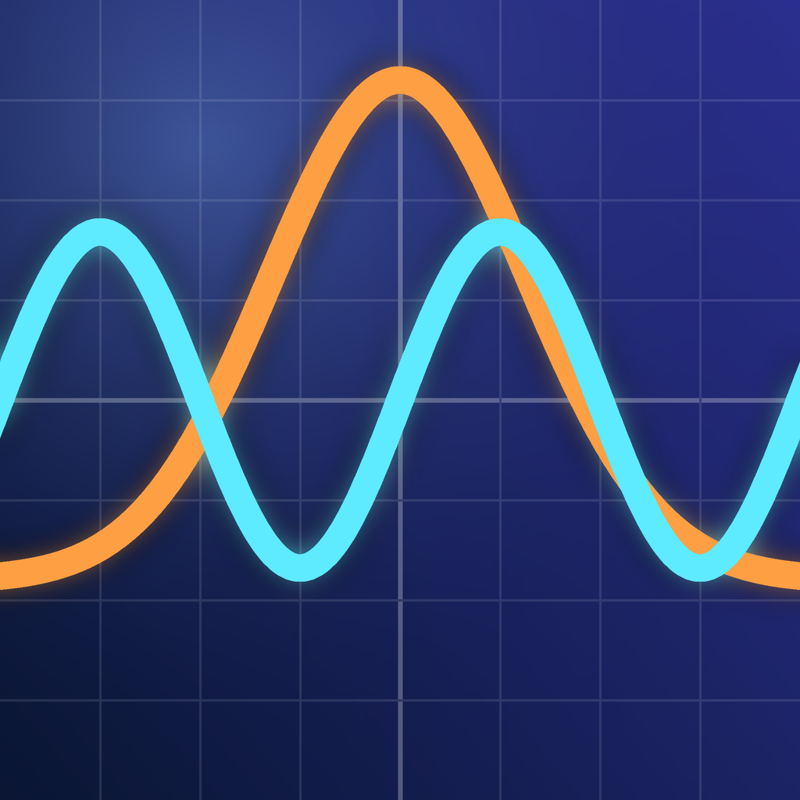

# Plotter — a native macOS function plotter

Plotter draws functions typed in LaTeX: curves y = f(x) or polar curves
r = f(θ) in a 2D graph, and surfaces z = f(x, y) or spherical surfaces
r = f(θ, φ) in a 3D graph. Each function has its own LaTeX box in the
sidebar. Above the box the formula is shown typeset, with its name (for example
*f(x) = sin x*), and the graph's legend shows the same typeset formulas.



## Using the app

| Action | 2D graph | 3D graph |
|---|---|---|
| Move / rotate | drag, or two-finger scroll | drag, or two-finger scroll |
| Zoom | pinch, mouse wheel, ⌘-scroll, ⌘+ / ⌘− | pinch, mouse wheel, ⌘+ / ⌘− |
| Reset the view | double-click, or ⌘0 | double-click, or ⌘0 |
| Read a value | hover over a curve | — |

- **⌘N** adds a function, **⌘1** / **⌘2** switch between the 2D and the 3D graph.
- The eye button hides a function; the coloured dot changes its colour;
  right-click a row to duplicate it, copy its LaTeX or delete it.
- Any letter other than x, y (and t, θ) is a **parameter** and gets a slider,
  e.g. `a\sin(kx)`.
- The toolbar's options button sets the 3D domain, resolution, colours
  (viridis, magma or the function's colour) and mesh lines.
- Functions and settings are saved automatically and restored at launch.

### What you can type

| Input | Meaning |
|---|---|
| `\sin x`, `y = x^2`, `f(x) = e^{-x^2}` | a curve in the 2D graph |
| `x^2 + y^2`, `z = \sin x \cos y`, `g(x, y) = xy` | a surface in the 3D graph |
| `\frac{a}{b}`, `\sqrt{x}`, `\sqrt[3]{x}`, `x^{2}`, `x^2`, `a_1` | fractions, roots, powers, subscripts |
| `\sin \cos \tan \cot \sec \csc`, `\arcsin \arccos \arctan`, `\sinh \cosh \tanh` | trigonometric and hyperbolic functions |
| `\exp`, `\ln`, `\log` (base 10), `\log_{2}` | exponential and logarithms |
| `\pi`, `e`, `\infty`, Greek letters (`\alpha` … `\omega`) | constants and parameters |
| `\cdot`, `\times`, `*`, `/`, implicit products (`2x`, `x\sin x`, `(x+1)(x-1)`) | multiplication and division |
| `\left( … \right)`, `[ … ]`, `|x|`, `\lfloor x \rfloor`, `\lceil x \rceil`, `x!` | brackets, absolute value, floor, ceiling, factorial |
| `\max(x, 0)`, `\min(…)`, `\operatorname{sgn} x` | further functions |

### Coordinate systems

The variables of a formula decide its coordinates: a formula in **x** is a curve
y(x) and one in **x, y** a surface z(x, y); a formula in **θ** alone is a polar curve
r(θ) and one with **φ** a spherical surface r(θ, φ). They are shown with their
coordinates, e.g. *r(θ) = 1 + cos θ*. The toolbar's segmented control next to
2D / 3D chooses the view: a Cartesian or **polar** grid in 2D, and a Cartesian or
true-scale **spherical** box in 3D; the input field then suggests an example in
those coordinates, and the info button beside it defines r, θ and φ.

| Input | Meaning |
|---|---|
| `1 + \cos\theta`, `r = \theta`, `r(\theta) = 2`, `f(\theta) = \sin 3\theta` | polar curve r(θ) in the 2D graph |
| `\sin\theta\cos\varphi`, `r = 2 + \cos\phi`, `r(\theta, \varphi) = 2` | spherical surface r(θ, φ) in the 3D graph (the last is a sphere) |

The angles may be typed as `\theta` and `\varphi` (or `\phi`), as plain `theta` and
`phi`, or directly as θ and φ. A formula that also uses x or y stays Cartesian, with
θ and φ as parameters; `y = …` and `z = …` are always Cartesian. In an `r` formula
only θ and φ may appear (x, y, z and t are rejected), and φ needs the spherical
form. Angles are in radians. θ in polar
coordinates is measured from the +x axis; in spherical coordinates θ is the polar
angle from the +z axis (0 … π) and φ the azimuth in the xy-plane from the +x axis
(0 … 2π), the physics (ISO 80000-2) convention: x = r sin θ cos φ, y = r sin θ sin φ,
z = r cos θ. A negative r points to the opposite side, and undefined radii (such as
√(cos 2θ) where cos 2θ < 0) are left out. Polar curves are drawn for θ from 0 to 4π
by default; the options button sets a longer range (up to 20π) for spirals such as
`r = \sin\frac{\theta}{3}`. A spherical surface is drawn to true scale: the 3D domain
±*a* limits the radius, and the box extends beyond ±*a* in x and y to keep the axes
in proportion.

### Level surfaces

An equation between two expressions of x, y and z is drawn as a surface in the 3D
graph, the set of points where both sides agree. Inside such an equation **r** stands
for the distance from the origin, r = √(x² + y² + z²).

| Input | Meaning |
|---|---|
| `e^{-r} = c` | a sphere; c is a free parameter, so it gets a slider (it starts at ½) |
| `x^2 + y^2 + z^2 = 4`, `z^2 = x^2 + y^2` | a sphere, a cone: any equation in x, y, z |

A formula alone (`e^{-r}`) is not a level surface: write the equation. `r = 2` with
nothing but a number or θ on the right is still a polar circle. The surface is found on a
grid over the 3D domain ±*a* (coarser than the surface grid) and is drawn to true scale;
a level outside the domain or the field's range gives an empty graph. For slices,
`z = e^{-\sqrt{x^2+y^2+c^2}}` is e^{-r} on the plane z = c, and `y = e^{-|x|}` is e^{-r} along a line.

Conventions: `-x^2` is −(x²); `2^3^2` is 2^(3²); `\sin x^2` is sin(x²);
`\sin 2x \cos x` is sin(2x)·cos(x); `\sin^2 x` is (sin x)²; `\sin^{-1} x` is
arcsin x; as in TeX, an unbraced exponent is one character, so `x^23` is x²·3.
Undefined points (such as √x for x < 0) are left out of the graph; poles and
jumps (tan x, 1/x, ⌊x⌋) are not joined by vertical lines.

If the LaTeX cannot be read, the box turns red, the message says why and the
offending characters are marked; the graph keeps the last valid version.

### Complex numbers

The imaginary unit is the upright i: `\mathrm{i}` (or `\mathrm i`, `\imath`).
Following ISO 80000-2, an italic `i` (plain `i` or `\mathit{i}`) stays an ordinary
variable and gets a slider.

A curve with complex values, such as `\sin{x} + \mathrm{i} \cos{x}` or
`e^{\mathrm{i} \omega x}`, is drawn twice in its colour: the **real part as a solid
line** and the **imaginary part as a dashed line**. The legend shows the key, and the
hover read-out gives both values. If the imaginary part is zero everywhere, only the
solid line is drawn.

| Input | Meaning |
|---|---|
| `\mathrm{i}`, `\imath` | imaginary unit, i² = −1 |
| `\Re z`, `\Im z` (also `\operatorname{Re}`, `\operatorname{Im}`) | real and imaginary part |
| `|z|`, `\arg z` | modulus and argument (phase, in (−π, π]) |
| `\overline{z}`, `\bar z`, `\operatorname{conj} z` | complex conjugate |

As soon as an expression contains the imaginary unit it is evaluated with complex
arithmetic, using principal values: `\sqrt{-4}` is 2i, `\ln(-1)` is iπ and
`\sqrt[3]{-8}` is 1 + √3 i. (Without the imaginary unit these stay real-valued:
√x is undefined for x < 0 and ∛(−8) = −2.) A surface z = f(x, y) must be real:
plot `\Re(…)`, `\Im(…)` or `|…|` of a complex expression.

## Building on a Mac

Requirements: **macOS 26** (Liquid Glass) and Xcode 26 or its Command Line Tools.
No Xcode project is needed.

```sh
git clone https://github.com/karoly-kubicsko/Plotter-macOS.git
cd Plotter-macOS
./build.sh --test --open   # runs the math tests, builds build/Plotter.app and opens it
```

To install, drag `build/Plotter.app` into `/Applications`.

## Ready-made download

Every version is on the repository's
[Releases](https://github.com/karoly-kubicsko/Plotter-macOS/releases) page as
`Plotter-<version>.zip`; [the latest release](https://github.com/karoly-kubicsko/Plotter-macOS/releases/latest)
is the current version. Unzip it to get `Plotter.app`.

The releases are made by CI on GitHub-hosted runners:

- every build of `main` (`.github/workflows/build.yml`, the same build on a macOS runner)
  publishes its app as the release of its version (tag `v<version>`); a later build of the
  same version replaces the app and moves the tag to the newer commit;
- `.github/workflows/releases.yml` published the earlier versions, 1.0 and 1.1, from the app
  their CI run on `main` built; it checks each app's version and leaves existing releases
  alone.

The build of any other branch is under the repository's **Actions** tab as
**Plotter-macOS** (kept for 90 days; it contains `Plotter.zip`), next to
**Plotter-screenshots** of the 2D and 3D views.

The app is ad-hoc signed, not notarised, so Gatekeeper blocks a downloaded copy the
first time it is opened. Either try to open it and then choose
**System Settings → Privacy & Security → Open Anyway**, or remove the quarantine
flag: `xattr -dr com.apple.quarantine Plotter.app`. A copy you build yourself with
`build.sh` opens directly.

## Versions

| Version | Release (Git tag) | Changes |
|---------|-------------------|---------|
| 4.0     | [`v4.0`](https://github.com/karoly-kubicsko/Plotter-macOS/releases/tag/v4.0) | Polar curves r(θ) on a polar grid and spherical surfaces r(θ, φ) drawn to scale; level surfaces F(x, y, z) = G with r = √(x² + y² + z²) (marching tetrahedra); the app icon in the About panel. |
| 2.0     | [`v2.0`](https://github.com/karoly-kubicsko/Plotter-macOS/releases/tag/v2.0) | The features of 1.1 under the version number 2.0. |
| 1.1     | [`v1.1`](https://github.com/karoly-kubicsko/Plotter-macOS/releases/tag/v1.1) | Complex numbers: the imaginary unit `\mathrm{i}`, Re, Im, arg and conjugation; complex curves are drawn as real part (solid) and imaginary part (dashed). |
| 1.0     | [`v1.0`](https://github.com/karoly-kubicsko/Plotter-macOS/releases/tag/v1.0) | LaTeX input with typeset formulas; 2D curves with adaptive sampling; 3D surfaces with Metal; Liquid Glass design. |

The installed app's version is shown under **Plotter → About Plotter**. To build a
specific version, clone its tag (Git's "detached HEAD" note is expected):

```sh
git clone --branch v1.0 https://github.com/karoly-kubicsko/Plotter-macOS.git Plotter-1.0
cd Plotter-1.0
./build.sh --open
```

## How it works

| Path | Purpose |
|---|---|
| `Sources/Math/Lexer.swift` | LaTeX tokenizer (also accepts π, θ, ·, ×, − typed directly) |
| `Sources/Math/Parser.swift` | recursive-descent parser → syntax tree; classifies curve / surface, finds parameters |
| `Sources/Math/Compiler.swift` | compiles the tree into closures with constant folding; domain errors give NaN |
| `Sources/Math/Complex.swift` | complex numbers (principal values) and the complex compiler, used when an expression contains the imaginary unit |
| `Sources/Math/Sampling.swift` | adaptive curve and polar-curve sampling with discontinuity detection, surface grids, 1-2-5 axis ticks |
| `Sources/Math/Field.swift` | fields F − G of level surfaces, sampled on a 3D grid; iso-surfaces by marching tetrahedra |
| `Sources/App/Typesetter.swift` | TeX-style typesetting (atom spacing, scripts, fractions, radicals, stretchy brackets) in STIX Two |
| `Sources/App/Plot2DView.swift` | 2D graph (SwiftUI Canvas), pan / zoom / hover |
| `Sources/App/Plot3DView.swift` | 3D graph (Metal): lit surface mesh, colormaps, mesh lines, labelled box, orbit camera with inertia |
| `Sources/App/Sidebar.swift`, `ContentView.swift`, `Model.swift`, `PlotterApp.swift` | window, sidebar, toolbar, glass overlays, state and persistence |
| `Tests/main.swift` | about 230 checks of the parser, the real and complex evaluators, samplers and labels (`./build.sh --test`) |
| `Icon/make_icon.py` | regenerates the icon (needs Pillow and NumPy) |
| `build.sh` | runs the tests (`--test`), compiles a universal binary, assembles and ad-hoc signs `Plotter.app` |
| `.github/workflows/build.yml` | CI: tests, builds (warnings are errors), launches the app in 2D and 3D, uploads the app and screenshots; publishes `main` as a release |
| `.github/workflows/releases.yml` | CI: published the earlier versions as releases |

The math engine (`Sources/Math`) uses only Foundation.
